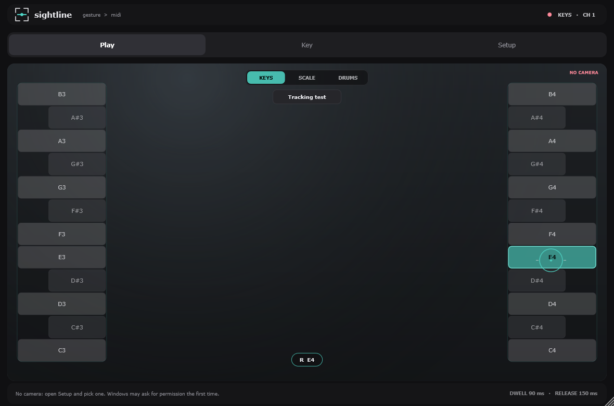
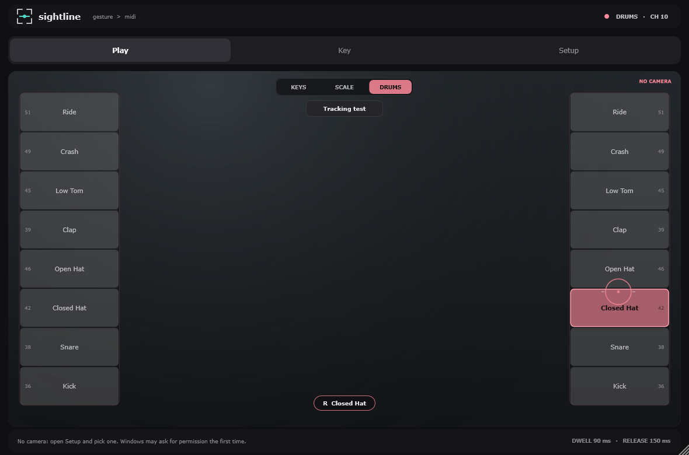
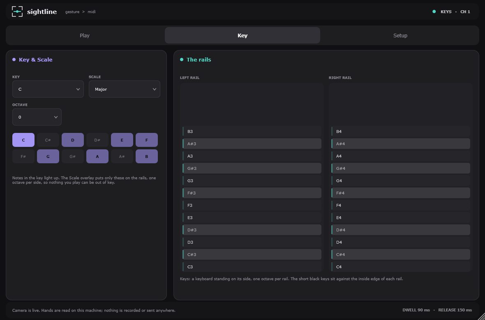
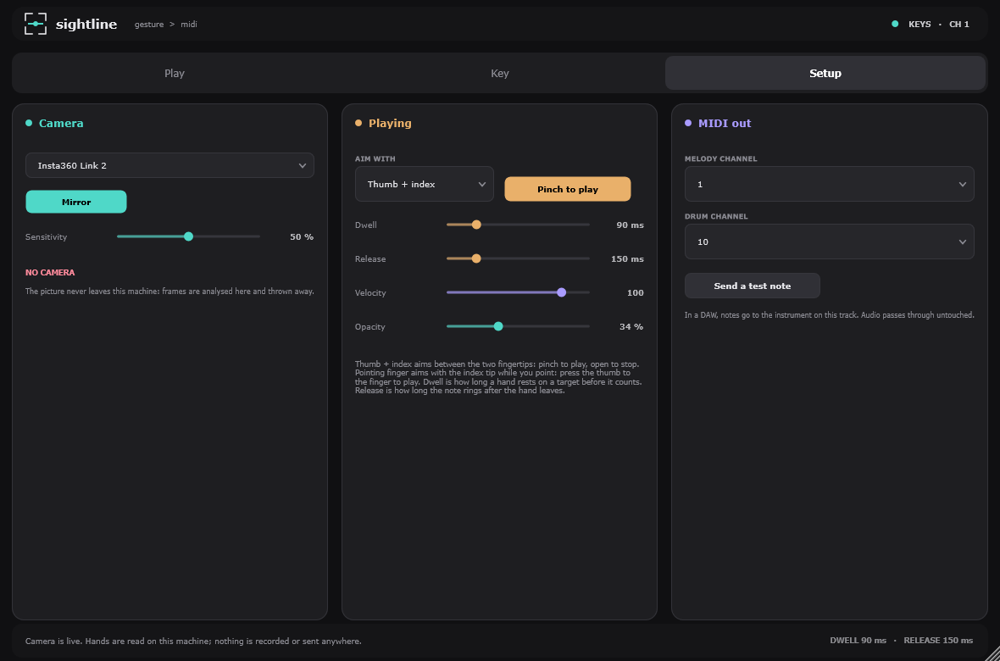

# sightline

A VST3 plugin and standalone Windows app that turns a webcam into a MIDI controller:
move a hand onto one of the translucent targets drawn down the sides of the picture and
the note (or drum) is played by whatever instrument the track is hosting.

The plugin never makes sound in a DAW: it sends MIDI out on the host's plugin MIDI port.
The standalone build adds a small built-in instrument (poly synth + drum kit) so it makes
noise on its own.

## Download

Every push to `main` builds the Windows installer and the VST3 and publishes them as the
[**latest**](https://github.com/invot/sightline/releases/tag/latest) release (see
`.github/workflows/release.yml`). The installer puts the standalone app in Program Files
and `sightline.vst3` in the shared VST3 folder; the zip is the VST3 bundle on its own.

## Screenshots

**Play**: the rails down both sides of the camera picture, with the overlay switch on top.
A hand is resting on E4 on the right rail.



**Play, Drums overlay**: the same eight-piece kit on both rails, with each pad's General
MIDI note number in its corner.



**Key**: key, scale and octave, and what each rail will play.



**Setup**: camera, how playing feels, and MIDI out.



These are rendered offscreen by the smoke harness, which has no camera attached, so the
picture behind the rails is a drawn test frame (see [Building](#building) to regenerate them).

## Building

Everything is built with the portable toolchain in `.tools` (MinGW-w64 GCC 16.2, CMake
3.31.6, JUCE 8.0.6), so no Visual Studio install is required.

```bash
./build.sh            # configure (first run) and build everything
./build.sh clean      # wipe build/ first
./build.sh tests      # build and run the JUCE-free core tests only
```

Outputs:

```
build/SightLine_artefacts/Release/VST3/sightline.vst3
build/SightLine_artefacts/Release/Standalone/sightline.exe
build/SightLineTests.exe       # zone map / dwell gate / detector / synth checks
build/SightLineSmoke.exe       # offscreen end-to-end harness (SIGHTLINE_NO_CAMERA=1)
```

The smoke harness can also render the UI pages to PNG. This is how the README
screenshots are made:

```bash
SIGHTLINE_SNAPSHOT_DIR=docs/screenshots ./build/SightLineSmoke.exe
```

`.tools/JUCE-8.0.6` carries a handful of small patches so JUCE 8 builds under MinGW:
the platform check, a few DirectShow/Windows Media gaps, Direct2D GUIDs, and the manifest
handling (see the comments at each patch site). A fresh JUCE checkout would need them
re-applied.

## Using it in a DAW

1. Copy `sightline.vst3` into `C:\Program Files\Common Files\VST3`, or add the
   `build/SightLine_artefacts/Release/VST3` folder to the plugin paths.
2. Add sightline to a track **in front of** the instrument you want it to play, and route
   sightline's MIDI output to that instrument (in most DAWs a MIDI-generating plugin feeds
   the next plugin on the track automatically).
3. Open the editor, go to **Setup** and pick the camera. The video appears on the **Play**
   page with the overlay rails.

Notes go out on the melody channel (default 1); drum pads go out on channel 10 by default,
with General MIDI note numbers, so a GM kit answers out of the box.

## Overlays

| Overlay | What is on the rails |
| --- | --- |
| **KEYS** | A chromatic keyboard standing on its side, one octave per rail. The short black keys sit against the inside edge, as on a piano. Left rail starts at C3, right rail an octave above (the Octave control moves both). |
| **SCALE** | Only the notes of the selected key, one octave per rail, so a hand can land anywhere on the rail and still be in key. |
| **DRUMS** | Kick, snare, closed hat, open hat, clap, low tom, crash and ride on both rails. |

Both rails are live at the same time: one hand per rail, so two notes can sound together.

## Playing

* Hold a hand over a target for the **dwell** time (default 90 ms) and the note starts;
  it keeps sounding while the hand stays there.
* Move off the target and the note stops after the **release** window (default 150 ms), so
  a hand crossing a gap does not chop the note.
* The key/scale/octave, dwell, release, velocity, sensitivity, overlay opacity, mirroring,
  channels and the built-in instrument's level are on the Play (overlay switch) and Setup
  pages. **Send a test note** confirms MIDI is reaching the instrument.

The tracker is a heuristic, not machine learning: it looks for skin tones and frame
motion inside the two side regions only (the face in the middle is outside the search
area). That keeps it fast and dependency-free, and it copes with a resting hand, but it
is worth knowing:

* Strongly coloured walls, warm lamps or a sleeve in frame can be picked up as a hand.
  Lower **Sensitivity** or move the light if a target fires on its own.
* A hand fully outside the side regions is ignored by design.
* A dark or gloved hand may only be found while it moves.
* Mirroring is on by default, matching how people expect a webcam to behave.

### Drum mapping

The drum pads send General MIDI notes by default, which a GM kit answers but many modern
kits (an Ableton Drum Rack, Battery, a sampler) do not. Right-click a pad on the Play
page and choose **MIDI learn**, then play the note on your controller: the pad's corner
shows the new note, and both rails follow it because they share one kit.

The mapping is saved with the project and restored when it is reopened. **Reset to GM
note** in the same menu goes back to the default. For the note to arrive, the track's
MIDI input has to reach sightline - monitor the track, or place sightline as a MIDI
effect in front of the kit.

### Tracking test

The **Tracking test** switch just below the overlay switch on the Play page draws what the detector
sees over the camera picture: teal is skin, amber is frame motion, bright cells are both,
and the shaded middle is the band that is never searched. Each hand's normalised
position, the target under it and the camera fps are shown in the corner.

Use it when a rail fires on its own (a warm wall or a sleeve shows up in the mask) or
refuses to fire (the mask never covers the hand, or the hand sits outside the rails).

## Licence

sightline is released under the [GNU Affero General Public License v3.0](LICENSE)
(AGPL-3.0). It links JUCE 8, used under JUCE's AGPL option, and the source for every
release is this repository.

## Layout of the source

```
Source/core/       JUCE-free: zones, scales, hand tracking, dwell gating, built-in synth
Source/            processor (parameters, MIDI queue), editor (camera, pages), standalone bridge
Source/ui/         native-drawn theme, stage with the rails, key page, setup page
Source/platform/   Windows manifest for the exe and for the DLL, MinGW UIA shim
Tests/             core tests and the offscreen smoke harness
```
